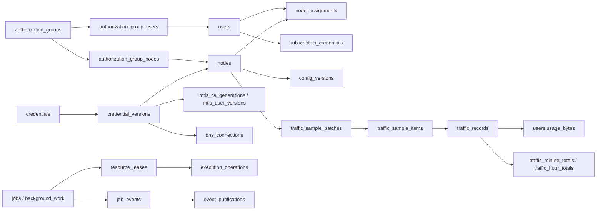

# 数据库表用途

本文按业务模块说明每张表存什么、由谁使用，以及关联和维护边界，供开发、排障和备份恢复时查阅。

核对日期：2026-10-28。范围为当前 `0001_baseline.sql` 和维护初始化代码，包含 **105 张应用持久表、1 张 SQLx 管理表、6 个普通视图**。

**版本边界：**基线合并原 0001～0074 SQL 迁移的最终结构，仅支持新建空库；原迁移链数据库不兼容，不支持原地升级。生产数据库仍属于原迁移链，本次代码整理不改变生产状态。SQL 基线与 Rust 维护初始化分开执行，正常 API 启动继续只校验就绪状态。

## 阅读约定与目录

- “键”列列出主键；涉及唯一约束或逻辑关联时在说明中补充。字段列表仅覆盖理解用途所需部分，完整 DDL 见各节迁移链接。
- `*_enc` 保存密文；`*_hash` 通常保存鉴权摘要。数据库之外的 `HYSTERIAX_MASTER_KEY` 必须独立保存。
- 多个 `generation` 分别服务于租约、缓存、授权、限制或刷新队列，不能互相替代；`revision` 通常表示实体或配置修订。
- “派生”表示可从来源计算，不表示可在运行中直接清空。刷新队列、版本、外键和事务约束仍须保持一致。

| 模块 | 应用表数 | 入口 |
| --- | ---: | --- |
| 管理鉴权与幂等 | 2 | [管理鉴权与幂等](#管理鉴权与幂等) |
| 节点、配置与套餐 | 8 | [节点、配置与套餐](#节点配置与套餐) |
| 用户、授权与撤销 | 10 | [用户、授权与撤销](#用户授权与撤销) |
| 凭据、分发与引用 | 9 | [凭据、分发与引用](#凭据分发与引用) |
| 托管 mTLS | 16 | [托管 mTLS](#托管-mtls) |
| DNS | 5 | [DNS](#dns) |
| 订阅模板 | 3 | [订阅模板](#订阅模板) |
| 流量账本与捕获 | 5 | [流量账本与捕获](#流量账本与捕获) |
| 监控采样 | 5 | [监控采样](#监控采样) |
| 统计读模型与刷新队列 | 15 | [统计读模型与刷新队列](#统计读模型与刷新队列) |
| 任务、事件与审计 | 8 | [任务、事件与审计](#任务事件与审计) |
| 后台调度、执行与维护 | 13 | [后台调度、执行与维护](#后台调度执行与维护) |
| 缓存版本 | 6 | [缓存版本](#缓存版本) |
| 合计 | **105** | 另见 [SQLx 管理表](#sqlx-管理表)、[视图](#视图) 和 [已移除表与临时表](#已移除表与临时表) |

## 主要数据关系

下图展示主要业务流中的关联；箭头包含逻辑使用关系，不全部是数据库外键。



## 管理鉴权与幂等

结构来源：[基线](../crates/hysteriax-server/migrations/0001_baseline.sql)。主要代码：[管理员令牌](../crates/hysteriax-server/src/api/admin_tokens.rs)、[管理写请求幂等](../crates/hysteriax-server/src/api/idempotency.rs)。

| 表 | 键 | 用途与关键关联 | 维护边界 |
| --- | --- | --- | --- |
| `admin_tokens` | `id` | 管理 API 的 Bearer 令牌目录；保存唯一 `token_hash`、标签、使用及撤销时间。 | 鉴权来源；不保存令牌明文。 |
| `management_receipts` | `(actor_id, operation, idempotency_key)` | 保存管理写请求摘要及加密响应 `response_enc`，重复请求可重放原响应，包括只返回一次的秘密。 | 与业务写入同事务提交；延迟触发器禁止空响应提交。无管理员外键，管理员移除后仍保留历史回执。 |

## 节点、配置与套餐

结构来源：[基线](../crates/hysteriax-server/migrations/0001_baseline.sql)。主要代码：[节点 API](../crates/hysteriax-server/src/api/nodes.rs)、[部署](../crates/hysteriax-server/src/deployment.rs)、[资源 API](../crates/hysteriax-server/src/api/resources.rs)、[节点限额](../crates/hysteriax-server/src/node_limits.rs)、[ACME 观测](../crates/hysteriax-server/src/node_acme.rs)。

| 表 | 键 | 用途与关键关联 | 维护边界 |
| --- | --- | --- | --- |
| `nodes` | `id` | 节点主档；SSH 端点及固定凭据版本、节点鉴权令牌、期望/已部署配置和修订、发布连接参数、部署与 mTLS 状态、流量捕获模式。 | 核心业务来源；期望配置不等于远端已部署配置。SSH 秘密在维护转换后改由凭据版本保存。 |
| `config_versions` | `id` | 节点配置历史；`(node_id, revision)` 唯一，保存加密快照、内容摘要和部署成功标记，供历史查看与回滚。 | 随节点级联删除；历史快照固定资源和凭据版本，删除需遵守引用约束。 |
| `config_resources` | `id` | 节点配置附件，保存名称、类型、加密内容、摘要和大小；`(node_id, name)` 唯一。ACL、GeoIP、GeoSite 等由此提供。 | 随节点级联删除；旧证书/私钥资源由维护逻辑转换到凭据系统，不能把初始 DDL 类型列表当成当前使用规则。 |
| `config_resource_references` | `(kind, source_id, source, resource_id)` | 从节点期望/已部署配置及历史快照提取的资源引用；外键约束资源与来源属于同一节点。 | 与凭据引用共用来源刷新机制；来源事务必须完成引用索引，防止仍被快照使用的资源被删。 |
| `node_packages` | `node_id` | 节点整机套餐配置和计量状态：周期、累计用量、下次重置、网卡计数基线、启动标识、限制状态。 | 一节点一行，随节点删除；这是整机配额计量，不能用用户流量总和替换。 |
| `node_network_samples` | `id` | 整机网卡的历史增量，含套餐周期、收发字节、缺口原因和基线标记；也是 `source='network'` 统计的来源。 | 随节点删除；普通监控的 31 天清理不清此表，涉及套餐计量和统计。 |
| `node_alerts` | `id` | 节点告警记录；`(node_id, kind, scope)` 唯一，以 `active` 表示告警是否仍有效。 | 随节点级联删除；由节点套餐/限额业务维护。 |
| `node_acme_observations` | `node_id` | 节点 ACME 组件状态观测，绑定配置修订、部署摘要、策略和采样时间。 | 观测不修改配置修订或 mTLS 激活状态；不保存节点本地 ACME 账户及证书私钥。 |

## 用户、授权与撤销

结构来源：[基线](../crates/hysteriax-server/migrations/0001_baseline.sql)。主要代码：[用户 API](../crates/hysteriax-server/src/api/users.rs)、[授权组](../crates/hysteriax-server/src/api/authorization_groups.rs)、[撤销调度](../crates/hysteriax-server/src/traffic/access.rs)、[断连请求](../crates/hysteriax-server/src/kick_requests.rs)。

| 表 | 键 | 用途与关键关联 | 维护边界 |
| --- | --- | --- | --- |
| `users` | `id` | 用户主档、启用状态、到期时间、配额、已计费用量、重置时间及访问撤销标记。 | `usage_bytes` 是配额鉴权所用的计费状态；不能从当前保留的历史明细随意覆盖。 |
| `node_assignments` | `(user_id, node_id)` | 用户实际获权节点及节点专属认证摘要/密文；由授权组变更协调生成，供节点认证和订阅使用。 | 随用户/节点删除；组关系和有效授权必须通过业务事务同步。旧直接客户端证书字段在维护转换中移除。 |
| `subscription_credentials` | `id` | 用户订阅 URL 令牌的摘要、密文、创建与撤销时间。 | 令牌摘要唯一，随用户删除；订阅还需检查用户状态与实际节点授权。 |
| `authorization_groups` | `id` | 授权组名称和修订，是批量管理用户与节点可见性的主实体。 | 删除会级联组成员关系和关联预览；需通过业务流程协调有效授权及撤销。 |
| `authorization_group_users` | `(group_id, user_id)` | 授权组的用户成员。 | 两端均有级联外键；与组节点集合共同决定授权结果。 |
| `authorization_group_nodes` | `(group_id, node_id)` | 授权组的节点成员。 | 两端均有级联外键；多个组授予同一节点时不能只凭一组移除就撤销实际授权。 |
| `authorization_group_previews` | `token` | 保存组创建/更新/删除及用户成员变更的请求摘要、状态守卫摘要、变更摘要、统计、必要签发计划、到期和消费时间；新预览不保存完整请求、快照和连接清单。 | 用于将提交绑定到已展示状态；会过期，不能作为长期授权来源。 |
| `user_access_checks` | `user_id` | 用户访问限制的到期检查索引，保存 `next_action_at`，避免反复扫描所有禁用、过期或超额用户。 | 派生调度状态；触发器随用户条件更新，维护模式负责初始化。 |
| `user_access_restriction_epochs` | `user_id` | 用户访问撤销事件的单调代次，供分页撤销工作识别自己是否已经过时。 | 独立于时间戳和用户修订；随用户删除，不能重置后继续旧工作。 |
| `node_limit_epochs` | `node_id` | 节点整机受限事件的单调代次，防止编辑套餐时误使未完成撤销分页失效。 | 独立于套餐计量/配置代次；随节点删除。 |

`kick_requests` 是跨任务保留的实际断连义务，见 [任务、事件与审计](#任务事件与审计)。`node_authorization_versions` 是部署准备时的授权变更守卫，见 [后台调度、执行与维护](#后台调度执行与维护)。

## 凭据、分发与引用

结构来源：[基线](../crates/hysteriax-server/migrations/0001_baseline.sql)。主要代码：[凭据模块](../crates/hysteriax-server/src/credentials/mod.rs)、[维护转换](../crates/hysteriax-server/src/credentials/migration.rs)、[引用索引](../crates/hysteriax-server/src/credentials/reference_index.rs)、[应用持久化](../crates/hysteriax-server/src/credentials/worker/persistence.rs)。

| 表 | 键 | 用途与关键关联 | 维护边界 |
| --- | --- | --- | --- |
| `credentials` | `id` | 统一凭据目录：名称、类型、所有者、最新版本、修订、归档和提醒时间。 | 不直接保存秘密载荷。当前维护转换后的类型含 SSH 密钥/密码、TLS 身份、CA 证书/身份、ECH 密钥、DNS 和 API 令牌。 |
| `credential_versions` | `(credential_id, version)` | 凭据的不可变加密载荷、公开元数据、兼容文件名和创建时间。 | 更新由触发器禁止；节点、快照、CA、DNS 等固定具体版本。删除受引用和保留策略约束。 |
| `credential_batches` | `id` | 一次凭据版本批量发布的主记录，固定 `credential_id + version`。 | 节点和 DNS 目标通过各自批次子表跟踪；不是工作进程内存队列。 |
| `credential_batch_items` | `(batch_id, node_id, user_id)` | 节点/用户目标的凭据应用项，保存预期修订、关联任务及 `applied_at/apply_stage`。 | 完成标记与应用变更需原子提交，重试不能再次改绑；随批次级联删除。 |
| `dns_credential_batch_items` | `(batch_id, connection_id)` | DNS 连接的凭据轮换应用项，关联任务、预期修订和应用时间。 | 引用凭据批次、DNS 连接与任务；与节点应用项分开记录。 |
| `credential_application_receipts` | `job_id` | 保存凭据应用完成时的来源、执行身份、阶段与结果，供任务交给同步流程后恢复原始应用结果。 | 已提交应用的完成证据；不能仅凭任务尚未最终成功就再次应用。 |
| `credential_migrations` | `name` | 一次性凭据数据转换的完成标记，如 `credentials_v2`、`tls_pairs_v1`。 | 与 SQLx DDL 迁移记录不同；删除标记可能使数据转换重复执行。 |
| `credential_reference_edges` | `(kind, source_id, source, field, credential_id, version)` | 配置引用具体凭据版本的索引，区分节点期望/已部署配置和历史快照，供引用展示与删除保护。 | 配置源是权威内容；外键与形状约束确保版本和历史来源有效。 |
| `credential_reference_dirty` | `(kind, source_id)` | 配置来源待重建引用的队列，带单调 `generation`；同时驱动资源引用重建。 | 普通业务事务提交前必须刷新对应来源；维护初始化可分批处理，完成后才允许运行。不是可任意丢弃的异步提示。 |

维护初始化还会修改部分结构：移除 `nodes` 的旧 SSH 秘密字段及 `node_assignments` 的旧客户端证书字段，收紧凭据类型。只阅读 `0001_initial.sql` 会得到过时字段含义，具体流程见 [凭据文档](credentials.md)。

## 托管 mTLS

结构来源：[基线](../crates/hysteriax-server/migrations/0001_baseline.sql)。主要代码：[CA](../crates/hysteriax-server/src/credentials/ca.rs)、[身份](../crates/hysteriax-server/src/credentials/identities.rs)、[激活](../crates/hysteriax-server/src/credentials/activation.rs)、[轮换](../crates/hysteriax-server/src/credentials/rotations.rs)。

| 表 | 键 | 用途与关键关联 | 维护边界 |
| --- | --- | --- | --- |
| `mtls_authorities` | `credential_id` | 托管 CA 主记录，关联凭据；保存来源、签发/续期策略、已发布版本和维护状态。 | `published_version` 才是操作中的 CA，不能用凭据最新版本替代。 |
| `mtls_ca_generations` | `(ca_id, ca_version)` | CA 各代的准备、发布、退役状态和有效期，固定不可变凭据版本。 | 每个 CA 最多一个准备代和一个发布代；退役不等于相关叶证书立即失效。 |
| `mtls_user_identities` | `id` | 用户在某 CA 下的稳定身份，关联独立 TLS 凭据，保存身份/授权修订、归档和调度信息。 | `(user_id, ca_id)` 唯一；用户删除后仍保留所有者标识，用于计算仍有效证书的信任保留边界。 |
| `mtls_user_versions` | `(identity_id, credential_version)` | 用户叶证书版本，固定 TLS 凭据版本和 CA 代，记录有效期、续期时间、物理发布/丢弃标记。 | 当前可用性应结合 `mtls_user_version_publication` 视图，不能只读物理 `released`。 |
| `mtls_probe_versions` | `(node_id, credential_id, credential_version)` | 节点探测客户端证书的历史版本及 CA 代、有效期、续期和丢弃状态。 | 节点删除后仍保留未过期版本记录，保护 CA 保留期限。 |
| `mtls_node_trust` | `(node_id, ca_id, ca_version)` | 节点对某 CA 代的期望和已部署信任成员关系，含修订。 | `desired` 和 `deployed` 必须区分，远端切换成功后才更新部署事实。 |
| `mtls_rotations` | `id` | 一次 CA 换代的主状态机，关联凭据批次，跟踪信任、身份、发布、探测阶段及错误/结果。 | `(ca_id, ca_version)` 唯一；同 CA 未完成轮换互斥，失败和替代结果仍是恢复依据。 |
| `mtls_rotation_nodes` | `(rotation_id, node_id)` | 每个节点在一次轮换中的进展：预期修订、信任准备、探测切换、任务和错误。 | 随轮换或节点级联删除；与轮换主状态协同推进。 |
| `mtls_trust_cleanup` | `(ca_id, ca_version)` | 旧 CA 信任移除的计划时间及完成标记。 | 必须等待仍可能使用该代的身份、探测及不确定激活满足清理条件。 |
| `mtls_cleanup_nodes` | `(ca_id, ca_version, node_id)` | 旧信任清理的节点级任务、完成状态及错误。 | 引用清理主记录；节点删除时级联删除。 |
| `mtls_node_operations` | `job_id` | 将节点任务绑定到 CA 代、轮换及 trust/cleanup 阶段，并保存基准配置、激活、摘要和恢复信息。 | `pending_job` 是任务状态的派生索引标记，不能替代任务权威状态和轮换结果。 |
| `mtls_active_probes` | `node_id` | 节点当前探测所用的 CA 代与探测凭据版本指针。 | 版本外键指向 `mtls_probe_versions`，一节点一行。 |
| `mtls_activations` | `id` | 一次节点 mTLS 激活的持久记录：任务、单调代次、目标修订/摘要、前态、加密快照、信任、探测身份和恢复阶段。 | `(node_id, generation)` 唯一；无节点外键以保留历史。更晚的失败尝试不能抹掉早期不确定激活。 |
| `mtls_activation_trust` | `(activation_id, ca_id, ca_version)` | 激活快照引用的 CA 信任集合，支持不确定远端激活的信任保留判断。 | 随激活记录删除；通过视图筛选仍可能生效的激活。 |
| `mtls_deployment_snapshots` | `(node_id, revision, activation_id)` | 配置修订对应的加密 mTLS 部署快照，用于恢复/历史配置与实际激活身份匹配。 | 引用激活；无节点外键，历史不只依赖节点当前指针。 |
| `mtls_operations` | `(actor_id, idempotency_key)` | mTLS 业务操作的请求摘要和 JSON 回执，包括自动维护发起的操作。 | 与通用 `management_receipts` 并存，属于 mTLS 业务幂等记录，不是远端执行日志。 |

更多状态转换、证书保留和恢复规则见 [托管 mTLS](managed-mtls.md)。

## DNS

结构来源：[基线](../crates/hysteriax-server/migrations/0001_baseline.sql)。主要代码：[DNS API](../crates/hysteriax-server/src/api/dns.rs)、[提供商](../crates/hysteriax-server/src/dns/provider.rs)、[执行](../crates/hysteriax-server/src/dns/execution.rs)、[凭据轮换](../crates/hysteriax-server/src/dns/rotation.rs)。

| 表 | 键 | 用途与关键关联 | 维护边界 |
| --- | --- | --- | --- |
| `dns_connections` | `id` | DNS 提供商连接、固定凭据版本、修订、验证状态和时间；当前提供商约束为 Cloudflare。 | 凭据通过复合外键固定；连接验证与远端操作分离。 |
| `dns_zones` | `id` | 连接下的区域目录、远端区域 ID、域名、是否启用、同步时间和修订。 | 区域远端 ID 与名称分别唯一；连接删除受引用约束。 |
| `dns_records` | `id` | DNS 记录本地状态：远端 ID/快照、期望内容、来源、同步状态、解析检查及软删除时间。 | `(zone_id, provider_record_id)` 唯一；本地 desired 不代表提供商已经应用。 |
| `dns_bindings` | `node_id` | 节点与域名、区域及记录 ID 集合的绑定，保存修订。 | 主机名唯一，随节点删除；仅删绑定不代表远端 DNS 已删除。 |
| `dns_operations` | `id` | DNS 操作的幂等意图、请求摘要、任务、连接/凭据版本、目标、动作、载荷与应用结果。 | `idempotency_key` 唯一；这是远端副作用恢复证据，需与通用执行日志一起保留。 |

DNS 连接凭据轮换还使用前述 [`dns_credential_batch_items`](#凭据分发与引用)，该表计入凭据模块。提供商调用共用资源租约与外部操作日志，见 [后台调度、执行与维护](#后台调度执行与维护)。

## 订阅模板

结构来源：[基线](../crates/hysteriax-server/migrations/0001_baseline.sql)。主要代码：[模板存储](../crates/hysteriax-server/src/api/subscriptions/templates/store.rs)、[模板渲染](../crates/hysteriax-server/src/api/subscriptions/templates/render.rs)。

| 表 | 键 | 用途与关键关联 | 维护边界 |
| --- | --- | --- | --- |
| `subscription_templates` | `id` | Mihomo/Sing-box 模板主档，加密草稿、修订、归档、每格式默认指针和已发布版本。 | 默认模板必须已发布且未归档；每种格式最多一个默认模板。 |
| `subscription_template_versions` | `(template_id, version)` | 不可变的已发布模板加密文档，供实际订阅生成读取。 | 主表 `published_version` 通过延迟复合外键引用；编辑草稿不改变已发布输出。 |
| `subscription_template_initialization` | `id=1` | 默认模板已经初始化的单行标记。 | 维护时只播种一次；恢复或重启不能通过删标记重置用户模板及发布状态。 |

订阅 URL 令牌保存在 `subscription_credentials`，实际节点访问来自 `node_assignments`，两者均不在模板表内。参见 [订阅](subscriptions.md)。

## 流量账本与捕获

结构来源：[基线](../crates/hysteriax-server/migrations/0001_baseline.sql)。主要代码：[计费](../crates/hysteriax-server/src/traffic.rs)、[批次处理](../crates/hysteriax-server/src/traffic/batches.rs)、[清零采集](../crates/hysteriax-server/src/traffic/clear.rs)。

| 表 | 键 | 用途与关键关联 | 维护边界 |
| --- | --- | --- | --- |
| `traffic_sample_batches` | `sample_id` | 一次持久捕获的主记录，预分配唯一 `sample_order`，保存节点/周期/实例、捕获状态、载荷摘要、项目数、处理进度和期限。保存历史捕获模式、清零请求执行身份和实例确认状态；0073 起只允许新建区间批次，切换检查字段已移除。 | 已捕获载荷在周期过期后仍须恢复结算；清零请求可能已改变远端计数，不能在接管时盲目重发。 |
| `traffic_sample_items` | `id` | 批次内逐用户捕获的收发计数与处理时间；`(sample_id, user_id)` 唯一，复合外键绑定批次及节点。 | 先持久化再分页结算；历史模式仅供解释旧记录；新批次的计数直接作为区间增量结算。`user_id` 无用户外键，允许保留未知/已删用户及探测条目。 |
| `traffic_baselines` | `(node_id, user_id)` | 用户在节点的上次计数基线、远端实例、采样时间与顺序。 | 保留历史计数和实例信息；当前结算仅使用顺序检查点防止迟到或重复写入，不再计算累计差额。随节点/用户删除。 |
| `traffic_records` | `id` | 已结算的逐用户流量增量账本，保存基线、增量、实例、缺口/基线标记、时间及样本 ID。 | 非空 `(sample_id, user_id)` 唯一以防重复入账；与用量、基线和批次进度原子更新。随节点/用户删除，不等于永久累计账单。 |
| `data_gaps` | `id` | 节点采样中断或不确定计量的缺口，记录打开/解决时间及原因。 | 用于解释数据完整性；补采成功不代表缺失区间可以被推算为零。随节点删除。 |

三个层次不能混用：`traffic_sample_items` 是待处理或已处理的原始捕获，`traffic_records` 是结算增量，`users.usage_bytes` 是当前用户配额状态。整机套餐另用 `node_packages` 和 `node_network_samples`。统计读模型展示当前保留来源的汇总，不替代配额账本。

## 监控采样

结构来源：[基线](../crates/hysteriax-server/migrations/0001_baseline.sql)。主要代码：[代理监控](../crates/hysteriax-server/src/proxy_monitor.rs)、[部署探测令牌](../crates/hysteriax-server/src/deployment/probe_tokens.rs)。

| 表 | 键 | 用途与关键关联 | 维护边界 |
| --- | --- | --- | --- |
| `online_samples` | `id` | 周期/节点的在线连接观测，保存用户连接映射、在线及流量采集状态、周期起点、期望节点数和 pending 标记。 | `(cycle_id, node_id)` 唯一；周期先写占位，采集后更新，缺失/失败不能当成在线为零。 |
| `proxy_probe_samples` | `id` | 节点某配置修订的入口/外部探测历史、连接耗时、延迟和失败原因。 | `(node_id, sampled_at)` 唯一；是可用率与探测历史的原始来源。 |
| `monitoring_probe_state` | `node_id` | 当前配置修订的探测健康状态和连续成功/失败计数。 | 用于健康状态收敛；历史样本不直接等同当前健康结论。 |
| `monitoring_probe_tokens` | `node_id` | 短期监控探测鉴权摘要和到期时间，绑定 work、owner、节点/work 代次及执行 epoch。 | 不能仅凭未到期就放行；必须验证有效执行归属。过期记录由监控保留任务清理。 |
| `deployment_probe_tokens` | `node_id` | 部署验证的短期鉴权摘要，绑定任务、owner、节点/任务代次和执行 epoch。 | 与常规监控令牌用途不同；历史未绑定执行身份的记录不构成有效执行证明。 |

`online_samples` 和 `proxy_probe_samples` 当前由监控保留任务按 **31 天**阈值分批删除，令牌按到期时间清理；每次最多 256 行并跳过已锁行。此规则不覆盖 `traffic_records`、`traffic_baselines` 或 `node_network_samples`。这些观测表均随节点删除。

## 统计读模型与刷新队列

结构来源：[基线](../crates/hysteriax-server/migrations/0001_baseline.sql)。主要代码：[统计](../crates/hysteriax-server/src/analytics.rs)、[周期刷新 SQL](../crates/hysteriax-server/src/analytics/refresh_cycles.sql)、[汇总刷新 SQL](../crates/hysteriax-server/src/analytics/refresh_rollups.sql)、[重试链刷新 SQL](../crates/hysteriax-server/src/analytics/refresh_retries.sql)。

| 表 | 键 | 用途与关键关联 | 更新方式/边界 |
| --- | --- | --- | --- |
| `traffic_minute_totals` | `(source, node_id, minute)` | 用户/整机网络的分钟流量、样本及不完整样本数；`source` 为 `users` 或 `network`。 | 原始流量行变更触发增减；分别来自 `traffic_records`、`node_network_samples`。 |
| `traffic_hour_totals` | `(source, node_id, hour)` | 分钟流量的小时汇总，减少长时间窗口查询成本。 | 通过脏小时刷新，不独立计费。 |
| `traffic_dirty_hours` | `(source, node_id, hour)` | 等待重算的流量小时及其 generation。 | 由分钟变更标记；刷新和精确代次确认同事务完成。 |
| `user_node_usage` | `(user_id, node_id)` | 当前保留流量账本的用户/节点收发总量、样本数和最近采样时间。 | 账本触发器维护；删除历史会调整，不等于用户全生命周期累计配额用量。 |
| `analytics_dirty_cycles` | `cycle_id` | 在线原始样本有变动的周期队列及 generation。 | 驱动 `online_cycle_metrics` 刷新。 |
| `online_cycle_metrics` | `(cycle_id, scope_node_id)` | 周期级在线用户去重数、连接数、覆盖/期望数及在线和流量完整性。 | 从 `online_samples` 派生；空字符串 scope 表示全局，其他值表示单节点。全局用户跨节点去重。 |
| `online_minute_totals` | `(scope_node_id, minute)` | 周期指标的分钟统计，保存用户/连接有效周期、总和、峰值及覆盖完整性。 | 从周期指标刷新；未知值与测得零值需区分。 |
| `online_dirty_minutes` | `(scope_node_id, minute)` | 等待重算的在线分钟及 generation。 | 由周期指标变化标记；全局 scope 同样使用空字符串。 |
| `probe_minute_totals` | `(node_id, minute)` | 每分钟有效探测尝试和成功次数，供可用率查询。 | 探测样本触发器维护；只计 `ok/failed`，外部探测失败不算成功。 |
| `job_status_totals` | `status` | 各任务状态的计数，供概览快速读取。 | 任务变更触发器维护。 |
| `job_node_kick_totals` | `node_id` | 每节点待执行断连任务、其中限额断连任务及失败限额断连任务计数。 | 任务变更触发器维护；不是 `kick_requests` 所有义务状态的替代品。 |
| `job_failed_minute_totals` | `minute` | 按完成分钟统计的失败任务数。 | 任务状态/完成时间变化时调整，保留每次尝试的历史口径。 |
| `job_retry_chain_state` | `leaf_id` | 线性重试链当前叶子的根 ID、显示名、状态、最近错误/失败时间及失败起点。 | 用于按重试链呈现故障，来源是 `jobs.retry_of_job_id`。 |
| `job_retry_chain_members` | `job_id` | 任务到重试链根的映射。 | 支持快速定位受影响的整条重试链。 |
| `job_retry_state_dirty` | `job_id` | 待刷新重试链的任务 ID 及 generation。 | 任务或重试关系变化时标记；不能用旧刷新结果确认较新变更。 |

刷新机制另用 `dirty_key_versions` 和 `analytics_retry_guards`，统一列在 [后台调度、执行与维护](#后台调度执行与维护)。

## 任务、事件与审计

结构来源：[基线](../crates/hysteriax-server/migrations/0001_baseline.sql)。主要代码：[任务](../crates/hysteriax-server/src/jobs.rs)、[任务持久化](../crates/hysteriax-server/src/jobs/persistence.rs)、[事件发布](../crates/hysteriax-server/src/events.rs)。

| 表 | 键 | 用途与关键关联 | 维护边界 |
| --- | --- | --- | --- |
| `jobs` | `id` | 持久业务任务：类型、目标配置修订、节点/资源快照、载荷、状态/阶段、结果、错误、日志、尝试次数和调度时间。 | `retry_of_job_id` 将显式重试串成单后继链。0002 已移除节点外键，节点删除后仍保留原 ID/名称。 |
| `job_events` | `id` | 任务事件源/outbox，保存事件类型和 JSON 载荷，供 SSE 及任务过程查看。 | 与任务有级联外键；ID 在提交前分配，不能直接当作可恢复发布顺序。 |
| `event_publication_stream` | `id=true` | 单行事件流 epoch 和已发布 head。 | 仅发布器协调发布序号；显式维护轮换 epoch，保留历史序号和事件。 |
| `event_publications` | `publication_seq` | 可重放发布顺序到唯一 `job_events.id` 的映射。 | SSE 游标使用 epoch 和此序号；来源事件删除时级联删除。 |
| `event_publication_pending` | `event_id` | 已提交事件等待发布的队列，避免扫描全部事件历史。 | 事件插入同事务入队，发布器分批发布并确认；不应人工清空。 |
| `audit_records` | `id` | 管理和系统业务操作审计：操作者、动作、实体类型/ID、详情及时间。 | 用于追溯业务变化；与任务事件、远端执行证据承担不同职责。 |
| `audit_totals` | `id=true` | 审计总行数的单行读模型。 | insert/delete/truncate 语句触发器维护，供列表总数读取。 |
| `kick_requests` | `(node_id, user_id)` | 跨任务保留的断连义务，记录原因集合、generation、当前状态及最新任务。 | 用户删除后仍保留用户 ID；节点删除时级联删除。失败任务不会自动消除撤销义务。 |

## 后台调度、执行与维护

结构来源：[基线](../crates/hysteriax-server/migrations/0001_baseline.sql)。主要代码：[后台调度](../crates/hysteriax-server/src/background.rs)、[维护工作](../crates/hysteriax-server/src/background/maintenance.rs)、[执行租约](../crates/hysteriax-server/src/execution.rs)、[远端执行](../crates/hysteriax-server/src/execution/remote.rs)、[复核 API](../crates/hysteriax-server/src/api/execution_rechecks.rs)、[启动契约](../crates/hysteriax-server/src/bootstrap.rs)。

| 表 | 键 | 用途与关键关联 | 维护边界 |
| --- | --- | --- | --- |
| `sampling_cycles` | `id` | 数据库时间对齐的采样周期、截止时间及冻结的期望节点数；`(kind, period_start)` 唯一。 | 周期创建时冻结节点成员工作，防止多实例重复创建及在线统计分母漂移。 |
| `background_work` | `id` | 周期采样及非周期维护的持久工作，含载荷/游标、状态、执行者、代次、可执行/截止时间。 | 采样通常引用周期并关联节点；维护工作可无周期/节点。只有运行态有 owner，接管受资源租约保护。 |
| `background_initialization` | `key` | 后台数据初始化完成标记，例如旧捕获批次接管和用户访问检查初始化。 | 普通启动校验这些标记；需维护模式完成初始化，不能伪造标记绕过未完成工作。 |
| `service_instances` | `instance_id` | 服务进程实例登记、启动时间与数据库心跳。 | 描述存活情况，不能单凭心跳或实例消失就重放外部副作用。 |
| `resource_leases` | `resource_key` | 节点、任务、后台工作等资源的排他租约，含 owner、单调 generation、到期、work、blocked 和 epoch。 | 释放后保留行以保持 fencing 代次。blocked 或未确认外部操作会阻止重新执行；不能当缓存删除。 |
| `execution_operations` | `operation_id` | 外部副作用的持久意图及证据，固定资源、执行者、代次、epoch、工作和步骤，跟踪 dispatching/verified/reconciling/needs_attention。 | `(work_id, step)` 唯一；普通操作不可因响应丢失盲目重放，需按证据复核。 |
| `execution_recheck_requests` | `namespace` | 远端执行复核请求命名空间和请求摘要的幂等预留。 | 保证同一复核请求不会被换成另一份输入；与实际复核过程分开保存。 |
| `execution_rechecks` | `id` | 可恢复的远端 fencing 复核过程，保存唯一请求命名空间、目标操作、准备数据、状态及证明。 | 同一 operation 最多一个 prepared/dispatching 复核；这是受类型约束的复核，不是重发原业务命令。 |
| `runtime_contract` | `id=true` | 已初始化 schema 版本、管理协议和共享主密钥指纹。 | 仅显式维护写入；正常启动校验一致性。指纹不包含主密钥。 |
| `node_authorization_versions` | `node_id` | 节点有效授权成员的单调版本，支持分页部署身份准备时判断来源是否变化。 | 由 `node_assignments` 成员变更触发更新；独立于缓存/监控版本，随节点删除及 ID 更新。 |
| `dirty_key_versions` | `(queue, entity_key)` | 各脏队列逻辑键的持续单调版本目录。队列项被确认移除后仍能避免版本从头开始。 | `hysteriax_mark_dirty` 同步更新目录和具体队列；不能只比较来源 ID 后清队列。 |
| `analytics_retry_guards` | `root_id` | 重试链根级互斥锁行，协调同链刷新和脏数据读取。 | 派生并发控制元数据；不是任务状态表。 |
| `monitoring_leases` | `node_id` | 0004 创建的旧监控 owner/到期租约表。 | 当前运行时代码未发现读写，表仍保留；现有采样由 `background_work + resource_leases` 协调。不能仅凭此文认定可从生产删除。 |

基线不包含全局业务写锁：没有 `hysteriax_serialize_writes` 触发器及函数。SQLx 维护迁移互斥、资源租约、行锁、约束和事务重试继续生效。流程见 [架构](architecture.md)。

## 缓存版本

结构来源：[基线](../crates/hysteriax-server/migrations/0001_baseline.sql)。主要代码：[缓存](../crates/hysteriax-server/src/cache.rs)、[缓存域](../crates/hysteriax-server/src/cache_domains.rs)、[配额排行](../crates/hysteriax-server/src/quota_rank.rs)。

| 表 | 键 | 用途与关键关联 | 维护边界 |
| --- | --- | --- | --- |
| `cache_version_epoch` | `id=true` | 数据库缓存快照身份；维护初始化轮换的 epoch 也用作执行 epoch 来源。 | 不能视为普通可清缓存；恢复后的旧租约凭证需要由新 epoch 隔离。 |
| `cache_bucket_versions` | `(domain, bucket)` | 每个缓存域 64 个桶的提交版本向量，用于列表/汇总等缓存有效性判断。 | 业务写事务提交时触发更新，避免所有写入争用单行全局版本。 |
| `cache_entity_versions` | `(kind, entity_id)` | 实体级缓存版本、删除墓碑、桶及桶版本；也驱动 Redis 配额排行增量更新。 | 删除墓碑和单调版本阻止旧数据回填，不能随实体删除一起简单抹掉。 |
| `cache_bucket_pending` | `(transaction_id, domain, bucket)` | 写事务内收集待增加的缓存桶，按键去重。 | 虽为普通持久表，记录只应存于未提交事务，提交前由延迟触发器刷新并删除。 |
| `cache_entity_pending` | `(transaction_id, kind, entity_id)` | 写事务内收集待增加版本的实体键。 | 与桶队列一并按固定顺序刷新，避免重复版本写入和锁序倒置。 |
| `cache_flush_pending` | `transaction_id` | 每个事务一次的刷新触发记录。 | 延迟约束触发器在提交时更新版本并删除三个 pending 表内该事务的行。 |

缓存值和排名可在 Redis 中重建；这些 PostgreSQL 版本、墓碑及 epoch 是验证其新鲜度的依据。清空 Redis 与清空以上表不是同一操作。

## SQLx 管理表

| 表 | 键 | 用途与关键关联 | 维护边界 |
| --- | --- | --- | --- |
| `_sqlx_migrations` | `version` | SQLx 自动建立的迁移历史，记录版本、描述、执行时间、成功状态和 checksum。 | 不在项目 `CREATE TABLE` 清单内。`bootstrap::check_schema` 将完整版本及 checksum 与镜像内嵌迁移逐项校验；不能伪造记录跳过尚未完成的迁移。当前生产经结构核验完成了[单基线元数据登记](installation.md#database-baseline)，没有重跑基线 SQL。 |

运行入口见 [db.rs](../crates/hysteriax-server/src/db.rs) 和 [bootstrap.rs](../crates/hysteriax-server/src/bootstrap.rs)。SQLx 历史记录和 `runtime_contract`、各初始化标记共同说明数据库是否可被当前服务安全使用。

## 视图

以下是 **6 个普通视图**，不单独持久存储业务行，也不是物化视图。

| 视图 | 来源/用途 | 定义 |
| --- | --- | --- |
| `credential_directory` | 将受管凭据、管理员令牌、订阅令牌和用户节点凭据合并为统一目录；CA 使用已发布版本计算状态。 | [基线](../crates/hysteriax-server/migrations/0001_baseline.sql)。 |
| `mtls_live_activation_trust` | 列出仍可能在远端生效的不确定激活信任；只有更晚已提交激活才排除旧不确定状态。 | [基线](../crates/hysteriax-server/migrations/0001_baseline.sql)。 |
| `job_cache_versions` | `cache_entity_versions` 中 `kind='jobs'` 的兼容投影。 | [基线](../crates/hysteriax-server/migrations/0001_baseline.sql)。 |
| `batch_cache_versions` | `cache_entity_versions` 中 `kind='credential_batches'` 的兼容投影。 | [基线](../crates/hysteriax-server/migrations/0001_baseline.sql)。 |
| `mtls_user_version_publication` | 在物理标记之上合成 CA 发布后的可见 released，以及从未发布即退役代的 discarded 状态。 | [基线](../crates/hysteriax-server/migrations/0001_baseline.sql)。 |
| `mtls_superseded_node_jobs` | 已有轮换 outcome 的节点任务；分页物化取消状态前，先用已提交替代事实阻止执行。 | [基线](../crates/hysteriax-server/migrations/0001_baseline.sql)。 |

## 已移除表与临时表

| 对象 | 历史用途 | 当前情况 |
| --- | --- | --- |
| `cache_generation` | 单行全局/配置缓存版本。 | 0045 删除，改用 epoch、桶版本和实体版本。 |
| `cache_domain_versions` | 单行每域缓存版本。 | 0045 删除，改用每域 64 桶版本。 |
| `job_cache_versions`（旧表） | 每任务缓存版本。 | 0045 删除实体表后，同名创建兼容视图。 |
| `batch_cache_versions`（旧表） | 每凭据批次缓存版本。 | 0045 删除实体表后，同名创建兼容视图。 |
| `traffic_history_cleanup_nodes` | 一次性历史清理的节点高水位、游标和删除进度。 | 原 0074 删除；当前基线不创建。 |
| `traffic_history_cleanup_runs` | 一次性历史清理的运行记录与候选计数。 | 原 0074 删除；当前基线不创建。 |
| `cache_source_domains`（临时表） | 原迁移链曾暂存旧触发器的缓存域映射，当前基线不创建。 | `CREATE TEMP TABLE ... ON COMMIT DROP`，基线不创建此临时表。 |

测试中的 `retry_counter`、`guarded_progress` 等仅在隔离测试 schema 内创建，不属于应用正式表。

## 常见排查与维护边界

| 现象/问题 | 优先检查 |
| --- | --- |
| 用户无法认证或没有订阅节点 | `users` → 授权组成员 → `node_assignments` → 节点部署/mTLS 状态；订阅 URL 另检查 `subscription_credentials`。 |
| 用户流量疑似重复、缺失或迟到 | `traffic_sample_batches/items` → `traffic_records` 的样本唯一键 → `traffic_baselines.sample_order` → `users.usage_bytes` 和 `data_gaps`；注意捕获模式。 |
| 整机套餐超额 | `node_packages`、`node_network_samples`、`node_limit_epochs`、`kick_requests`，不要用用户采样代替网卡计量。 |
| 图表与原始行暂时不一致 | 对应分钟/小时读模型、脏队列及 `dirty_key_versions`；在线图表还要区分覆盖不足与测得零值。 |
| 工作一直无法接管 | `jobs/background_work` → `resource_leases` → `execution_operations`；不确定副作用需要证据复核，不能直接删租约。 |
| 凭据或资源无法删除 | 当前/历史引用索引、固定版本外键、mTLS 代及仍有效/不确定信任引用。 |
| DNS 本地状态与远端不一致 | `dns_records` 的 desired/remote_snapshot、`dns_operations`、关联任务及执行证据。 |
| SSE 漏事件或游标失效 | `job_events`、pending、publication 映射及 stream epoch/head；不要用事件 ID 代替发布序号。 |
| 启动拒绝数据库 | `_sqlx_migrations`、`runtime_contract`、`credential_migrations`、`background_initialization` 及引用就绪状态。 |

备份应以完整数据库为单位，并独立保存对应主密钥。执行意图、DNS 操作、断连义务、mTLS 激活、应用回执、复核证据、租约版本与墓碑均不应按“缓存”处理。数据库恢复还须核对备份之后的外部副作用时间线，详见 [备份与恢复](backup-restore.md)。

普通监控历史可由现有保留任务清理；节点删除使用有界历史清理及持久游标。没有在上文列出保留期限的表，不应据此推断存在自动 TTL。修改源表时还可能触发统计调整、引用约束和缓存版本更新，直接 `TRUNCATE` 不等同业务删除。

## 核对实际数据库与维护本文

本次只读取仓库，未连接或修改生产数据库。可在目标库使用以下只读查询核对实际结构及迁移版本；请使用目标实例正确的 schema。

```sql
SELECT table_name, table_type
FROM information_schema.tables
WHERE table_schema = current_schema()
ORDER BY table_type, table_name;

SELECT version, description, success
FROM _sqlx_migrations
ORDER BY version;

SELECT schema_version, management_protocol, initialized_at
FROM runtime_contract
WHERE id;
```

新增/移除表或将表改为视图时，应同步更新目录计数和对应用途；用途变更还需检查维护初始化中的 Rust 数据转换。只修改索引的迁移通常不新增表，不能以迁移文件数量推算表数。对部署库的实际结论，须结合上述查询、对应镜像版本及维护初始化是否成功。
